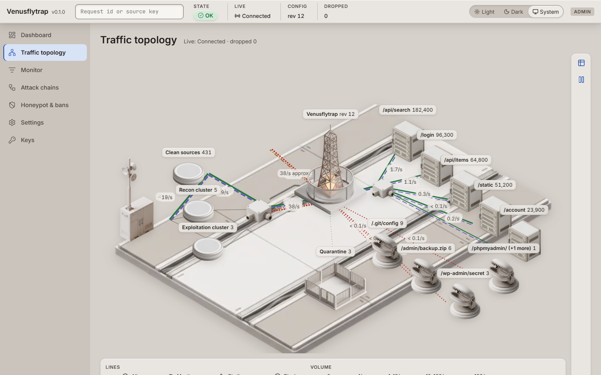
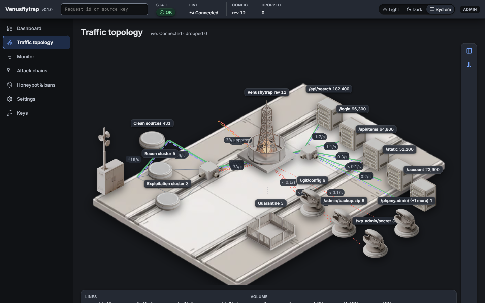
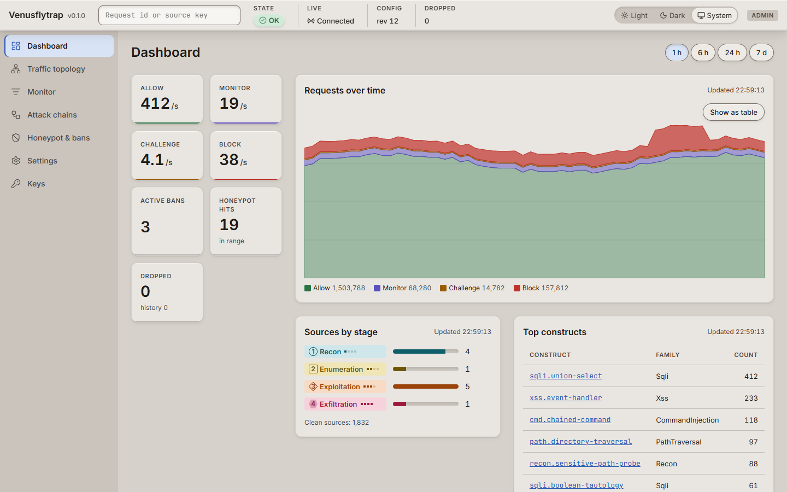
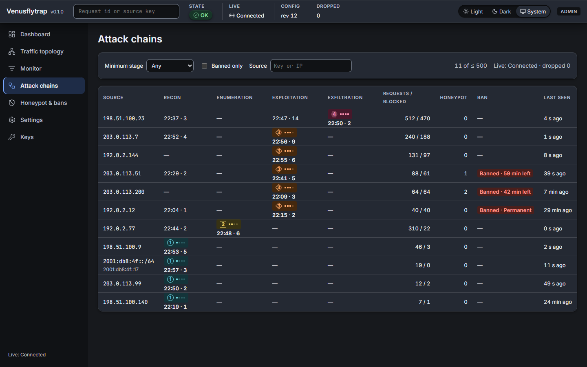

# Venusflytrap 🪰

A semantic, **taint-graph** web-application-firewall engine with a honeypot and
cross-request attack-chain inference — written in Rust, with **no unsafe code**.

The thesis: don't guess *what a payload looks like* (regex signatures that break
on encoding, or AST parsers that fail open on malformed input) — reason about
*what it can do* by normalizing the input, building a token graph, and checking
whether attacker-controlled data reaches a dangerous construct.

> **Honesty note.** Every design claim is grounded in published work in
> [`docs/RESEARCH.md`](docs/RESEARCH.md), and any headline number is treated as a
> *target to measure*, not a result to assume. In particular, Venusflytrap does
> **not** claim "zero false positives" as a property — it reports the measured
> false-positive count on a stated corpus.

## Pipeline

```
request → normalize → token-graph taint → detectors → four-valued lattice → score/verdict
              │             │                 │              │
         14-layer      source→sink        graph/taint    Belnap logic:
         decode +      reachability       signature      None/Safe/
         UTS#39        (mutation-         intent/recon   Suspicious/
         confusables   robust)            api-safety     Dangerous
         folding                          AI (pluggable) + arbitration
                                                              │
                          honeypot ── intel ── chain (kill-chain stages) ──┘
```

## Measured results

Measured on a real labelled corpus (33,877 HTTP requests: 33,219 benign, 658 malicious), through both the
stateless library path and the stateful serve path that the proxy runs. Recall is over the 656 malicious
files that were readable on the measuring machine (43.77% if the two unreadable files count as missed).
Full method, ban effects, mutation robustness, latency and limits are in
[`docs/BENCHMARK.md`](docs/BENCHMARK.md). That includes the shared-source ban check, which failed under
the first ban policy and passes after the ban-policy redesign.

| Engine | TP | FP | Recall | Precision | FP rate |
|---|---|---|---|---|---|
| Venusflytrap, library | 288 | 278 | 43.90% | 50.88% | 0.84% |
| Venusflytrap, serve (distinct sources) | 288 | 278 | 43.90% | 50.88% | 0.84% |
| Venusflytrap, serve (100 shared sources) | 288 | 278 | 43.90% | 50.88% | 0.84% |
| libinjection | 214 | 93 | 32.52% | 69.71% | 0.28% |

These are modest numbers and they are reported as measured. The baseline reads a slightly different
parse of the same corpus. `venusflytrap bench` is a synthetic smoke test, not a result.

## Operator console

The console (`ui/`) is an operator UI built to answer three questions quickly: is the shield healthy and
what is it stopping, why was this request blocked and which setting decided it, and what do I change.

<table>
  <tr>
    <td width="50%"></td>
    <td width="50%"></td>
  </tr>
</table>

*Traffic topology, light and dark. Every node is keyboard-focusable, and a table view carries every number the
map shows.*

<table>
  <tr>
    <td width="50%"></td>
    <td width="50%"></td>
  </tr>
</table>

*Dashboard (light) and Attack chains (dark). All figures in these screenshots come from deterministic
fixtures, not from a running shield, and are not results.*

What exists today:

- **Shell.** Top status bar (worst component state, config revision, live-connection state, dropped-event
  count, theme switch) and a navigation rail. Themes are light, dark or system.
- **Dashboard.** Allow / Monitor / Challenge / Block rates, requests over time (with a table alternative),
  sources by kill-chain stage, top constructs, active bans and honeypot hits.
- **Traffic topology.** An isometric scene of source clusters by stage, the shield, the busiest route
  groups, honeypot decoys and a quarantine pen. Line colour, dash pattern and width carry the verdict and
  volume; moving packets are motion only and stop under reduced motion.
- **Attack chains.** A grid of sources against Recon, Enumeration, Exploitation and Exfiltration with the
  first-reached time and a count per cell, ban state, and filters for minimum stage, banned-only and source.
- **Accessibility.** Verdicts and stages always carry a glyph and a word, never colour alone.

**Status.** This is SP6a. The shell, Dashboard, Traffic topology and Attack chains run on deterministic
fixtures; nothing is wired to a backend yet (the admin API and live channel arrive in later sub-projects,
SP3 to SP5). Monitor, Request details, Source, Honeypot & bans, Settings and Keys are placeholders planned
for SP6b.

Verified quality bar: axe-core reports zero serious or critical violations in the light and dark themes on
the screens above, the strict Content Security Policy holds with no inline styles, and the initial JavaScript
is about 29 KB gzipped against a 150 KB budget.

The isometric props and empty-state scenes are generated images kept out of git until their licence is
confirmed, so a fresh clone builds without them and simply omits the images.

Run it:

```bash
cd ui
npm install
npm run dev     # http://localhost:5173 ; append ?static to freeze the simulated live feed
```

Test commands and the screenshot script are in [`ui/README.md`](ui/README.md).

## Usage

```bash
# Inspect one request (exit code 2 if blocked)
venusflytrap scan --path "/items" --query "1 union select password from users"

# Synthetic smoke test (writes target/bench/BENCHMARK-synthetic.md; not a result)
venusflytrap bench --seed 1337 --n 2000

# Real-corpus evaluation (library path, or serve path through Pipeline::decide)
venusflytrap eval --corpus path/to/testcases --mode library
venusflytrap eval --corpus path/to/testcases --mode serve --sources pooled:100

# Reverse proxy in front of a local app (observation mode with --monitor-only)
venusflytrap serve --bind 127.0.0.1:8080 --upstream http://127.0.0.1:3000 --audit audit.jsonl
```

As a library:

```rust
use vft_core::{Shield, Config, Request, Verdict};

let shield = Shield::new(Config::default());
let mut req = Request::get("/items");
req.query.push(("id".into(), "1 union select password from users".into()));
assert_eq!(shield.inspect(&req).verdict, Verdict::Block);
```

## Running as a service

`venusflytrap serve` runs the proxy, an admin listener and a history store in one process:

```bash
venusflytrap --config venusflytrap.yaml serve \
  --bind 0.0.0.0:8080 --upstream http://127.0.0.1:3000 \
  --audit audit.jsonl --exceptions exceptions.yaml \
  --admin-bind 127.0.0.1:8899 --state-dir ./state
```

| Flag | Meaning |
|---|---|
| `--bind` | Proxy listener (default `127.0.0.1:8080`). |
| `--upstream` | The application to protect (required). |
| `--audit`, `--audit-max-mb`, `--ocsf` | JSONL and OCSF audit files and the size at which they rotate. |
| `--monitor-only` | Log decisions, never block. |
| `--exceptions` | Scoped exceptions file; re-read on reload. |
| `--admin-bind` | Admin listener, a loopback `host:port`, or `off`. Default: `admin.bind` from the config (`127.0.0.1:8899`). Non-loopback addresses are refused: there is no authentication yet. |
| `--state-dir` | Directory for `history.db` (default `./state`, created if missing). |
| `--no-history` | Run without the history database. |

**Admin endpoints** (loopback only):

| Endpoint | Returns |
|---|---|
| `GET /api/v1/health` | `{"ok": true}` while the process answers. |
| `GET /api/v1/status` | Health of each component (proxy, config, bus, history), the live config revision, restart-required keys, bus drops, version, uptime. |
| `GET /metrics` | Prometheus text: requests by verdict, latency histogram, bus drops, reloads, history rows written and dropped, history queue depth, config revision. |
| `POST /api/v1/reload` | Re-read the config and exceptions files and swap them in. `200 {"rev": n}` on success; `422 {"rev": n, "issues": [...]}` and the running config stays when the files are invalid. |

**Reload.** `SIGHUP` (Unix) and `POST /api/v1/reload` do the same thing. The files are read, validated and built
before anything is swapped, so a bad file never replaces a good config. Options that need a restart (for example
`limits.max_body`) keep their running value and are listed under `restart_required` in `/api/v1/status`.
`Ctrl+C` and `SIGTERM` stop accepting, drain in-flight requests, then flush and close the history store.

**History.** Every decision is counted in a per-minute rollup; every non-Allow decision, every decision an
exception touched and a sample of the rest (`history.allow_sample_rate`, default 0.01) is stored as a row, with
the kill-chain events, bans (restored at start) and config revisions. Rows are kept `history.retention_days`
days (default 14). Writing never blocks the proxy: when the writer falls behind, rows are dropped and counted
(`vft_history_rows_dropped_total`).

**Querying.** `venusflytrap history query` reads `<state-dir>/history.db` read-only, so it works while the
service runs. Terms are ANDed; `-` negates one. It prints a page as JSON and exits 2 on a bad query.

```bash
# Blocked SQL injection in a 24-hour window, newest page of 100 rows
venusflytrap history query --state-dir ./state \
  --q "verdict:block construct:sqli.*" \
  --from 2026-10-30T00:00:00Z --to 2026-10-31T00:00:00Z

# Which constructs fired on non-Allow requests from one /24, counted
venusflytrap history query --state-dir ./state \
  --q "-verdict:allow src:203.0.113.0/24" --group-by construct \
  --from 2026-10-24T00:00:00Z --to 2026-10-31T00:00:00Z
```

Terms: `verdict:`, `stage:`, `construct:` (a trailing `.*` is a prefix), `technique:`, `src:` (an address or an
IPv4 `/8`, `/16`, `/24`), `path:` (an absolute path prefix), `method:`, `cause:`, `exception:`, `group:`, `sampled:true|false` and
`score:50` or `score>=50` (also `>`, `<`, `<=`). `--group-by` takes `src`, `path`, `construct`, `stage` or `verdict`; `--cursor`
takes the `next` value of the previous page.

Measured overhead, reload behaviour under load and query times:
[`eval/RESULTS-B12-runtime-history.md`](eval/RESULTS-B12-runtime-history.md).

## Workspace

- `crates/vft-core` — the engine (normalize, graph/taint, lattice, detectors,
  honeypot, chain, intel). No I/O, no network, deterministic.
- `crates/vft-proxy` — hyper reverse proxy, decision headers, JSONL audit log.
- `crates/vft-cli` — `scan` / `bench` / `serve` plus the benchmark corpus and
  baselines.
- `ui/` — the operator console (Svelte 5 + Vite); see [Operator console](#operator-console).

## Documents

- [`docs/RESEARCH.md`](docs/RESEARCH.md) — claim-by-claim feasibility review.
- [`docs/PRD.md`](docs/PRD.md) — requirements and non-goals.
- [`docs/TECH_SPEC.md`](docs/TECH_SPEC.md) — architecture and data model.
- [`docs/IMPLEMENTATION_PLAN.md`](docs/IMPLEMENTATION_PLAN.md) — build phases.
- [`docs/BENCHMARK.md`](docs/BENCHMARK.md) — real-corpus results, library and serve side by side.
- [`docs/superpowers/specs/2026-10-25-console-design.md`](docs/superpowers/specs/2026-10-25-console-design.md) — operator console design spec.
- [`docs/superpowers/design/console-ux-architecture.md`](docs/superpowers/design/console-ux-architecture.md) — console screens, behaviour and copy.
- [`docs/superpowers/design/console-design-system.md`](docs/superpowers/design/console-design-system.md) — console tokens, components and topology styling.

## Safety & limits

- `#![forbid(unsafe_code)]`; all decode/graph work is bounded (payload cap,
  decode-depth cap, node cap) and fuzz-tested to never panic or hang.
- This is a **research-grade reference implementation**, not a drop-in
  enterprise WAF. The "AI" detector is a deterministic heuristic by default
  (pluggable via the `AiOracle` trait); threat intel is file-backed/offline.
- Known hard problems it does not magically solve: parser-differential evasion
  (WAFFLED-style) and adversarial mutation (WAF-A-MoLE) — see RESEARCH.md.
- **Known open fail-opens (forwarded uninspected today):** field content past
  `shield.max_payload` (65,536 characters per field; in practice the rest of a
  request body up to the 1 MiB body limit), tokens past the 4,096-token graph
  cap, and a percent-encoded layer that does not decode to valid UTF-8 (left
  encoded). Fixes are planned. The `Content-Length` header is forwarded without
  inspection (it is validated as a length); `Connection` is not inspected and
  never forwarded. Details: [`docs/BENCHMARK.md`](docs/BENCHMARK.md) section 7.

## License

Apache-2.0.
